# 1. Cover page

# FunZone

## Real-Time Multiplayer Mini Games Platform

### A BSc Information Technology mini-project report

**Developed by:** Aarzoo Khan  
**Roll number:** 20  
**Course:** Bachelor of Science, Information Technology  
**Academic year:** 2026–2027  
**College:** SMT. JAMNABAI H. WADHWA COLLEGE OF TECHNOLOGY  
**Project guide:** Meghna S.  
**Submission date:** 23 November 2026

**Repository:** https://github.com/khanaarzoo0987654321/funzone  
**Live website:** https://funzone-k94k.onrender.com  
**Audited commit:** `eedb4b2d7c8298e8ff5787a3da6dc83faa64ee11`

> All academic details in this report have been filled with verified college and student information.

---

# 2. Certificate

**CERTIFICATE**

This is to certify that the mini-project entitled **“FunZone – Real-Time Multiplayer Mini Games Platform”** has been prepared and submitted by **Aarzoo Khan** in partial fulfilment of the requirements for the degree of **Bachelor of Science, Information Technology** during the academic year **2026–2027**.

The work presented in this report is based on the actual FunZone repository and deployed application. The online multiplayer, local multiplayer, authentication, REST API, game engines, testing and deployment sections were verified during the final audit dated 20 November 2026.

Place: Mumbai  
Date: 23 November 2026

| | |
| --- | --- |
| ___________________________ | ___________________________ |
| Project Guide Meghna S. | Head of Department Reshmi J. |

---

# 3. Declaration

**DECLARATION**

I, **Aarzoo Khan**, declare that the mini-project entitled **“FunZone – Real-Time Multiplayer Mini Games Platform”** and the contents of this report are prepared from the work carried out in the FunZone project repository.

The technical details, database design, test results and deployment information in this report are based on the project files and live verification performed on 20 November 2026. All college, guide, roll number, academic year and date details were supplied and verified before final submission.

Date: 23 November 2026  
Place: Mumbai

___________________________  
Aarzoo Khan

---

# 4. Acknowledgement

I would like to acknowledge the support of **SMT. JAMNABAI H. WADHWA COLLEGE OF TECHNOLOGY**, the Department of Information Technology, and my project guide **Meghna S.** for their guidance during this mini-project.

I also acknowledge the open-source technologies that made FunZone possible: React, Vite, Node.js, Express, Socket.IO, MySQL, JWT, bcryptjs, Render and GitHub. The documentation and community examples provided by these projects helped in understanding and applying the concepts used here.

Finally, I thank everyone who reviewed the live pages and pass-and-play flows during the project checks.

---

# 5. Abstract

FunZone is a browser-based gaming platform that allows players to enjoy five mini games—Tic Tac Toe, Rock Paper Scissors, Connect Four, Memory Match and Quick Tap—in two different ways. In **online multiplayer**, players create a room, share a six-character code, ready up and play in real time through Socket.IO. Accounts, match history, leaderboards and achievements are supported. In **local multiplayer**, players pass a single device through privacy handoff screens; no account, socket session or online result storage is required.

The application uses a React 18 single-page frontend built with Vite 6 and a Node.js/Express backend. REST endpoints handle authentication, rooms, profiles, matches and leaderboard data, while Socket.IO handles live room state, chat, readiness, game actions and end notifications. Five authoritative game engines validate turns, timers and scores on the server. The same engine modules are reused by the local pass-and-play driver, so both modes share consistent game rules.

Authentication uses JWT bearer tokens and bcryptjs password hashing. Data can be stored in MySQL 8 using the supplied schema or in an automatic in-memory fallback. The live Render deployment uses memory mode. Security measures include Helmet headers, a CORS allowlist, rate limiting on authentication endpoints, server-side validation and hidden online card symbols.

The final audit verified GitHub branch and commit status, secret handling, live pages, `/api/health`, deployment of the latest commit, all five local games on the live site, one complete online Tic Tac Toe match, 32 passing automated tests and a successful production build. No blocking failure was found. Live MySQL mode and a few documentation gaps are explicitly recorded as limitations or manual checks.

**Keywords:** React, Vite, Node.js, Express, Socket.IO, REST API, JWT, bcryptjs, MySQL, multiplayer games, local multiplayer, Render.

---

# 6. Table of contents

1. Cover page  
2. Certificate  
3. Declaration  
4. Acknowledgement  
5. Abstract  
6. Table of contents  
7. Introduction  
8. Problem statement  
9. Objectives  
10. Scope  
11. Existing system and proposed system  
12. Feasibility study  
13. Software and hardware requirements  
14. Technology stack  
15. System architecture  
16. SDLC methodology  
17. DFD Level 0 and Level 1  
18. Use case diagram  
19. ER diagram  
20. Database design  
21. Module descriptions  
22. Online multiplayer functionality  
23. Local multiplayer functionality  
24. Detailed explanation of all five games  
25. UI screenshots or screenshot placeholders with instructions  
26. Implementation details  
27. Testing strategy and actual test results  
28. Deployment process  
29. Security considerations  
30. Limitations  
31. Future enhancements  
32. Conclusion  
33. Bibliography  
34. User manual

---

# 7. Introduction

FunZone is a full-stack web application developed to make short, fair multiplayer games easy to start from a browser. It combines five games into one platform and supports both remote play through room codes and face-to-face play on one device.

The online experience is built around a six-character room code. A player signs in, creates a room, shares the code and waits for other players. Socket.IO keeps every player's screen synchronised. The server, not the browser, owns the game state and decides the result. This prevents clients from claiming false scores.

The local experience is intentionally simpler. A user opens `/local`, selects a game, enters player names and passes the device. Full-screen handoff screens hide the previous player's information. Local matches use the same game rule modules as online matches but never open a socket, call REST or save results online.

The project is deployed as a single Render Web Service. Express serves the built React app and also hosts the REST API and Socket.IO endpoint on the same HTTPS origin. This simplifies CORS, cookies are not required for authentication, and the same URL works for both the website and live game connection.

---

# 8. Problem statement

Organising a quick multiplayer game usually has several difficulties:

- Players may need to install different apps or create accounts on third-party services.
- Manual scorekeeping can lead to disputes.
- A client-side game can be modified to report fake results.
- Friends sitting together need a fair way to hide choices while sharing one device.
- Separate tools are often needed for accounts, match history, leaderboards and achievements.
- A deployment must be simple enough to demonstrate from any browser without a complex infrastructure.

FunZone addresses these problems by providing one web application with server-validated online play, privacy-focused local play, persistent data support and a live HTTPS deployment.

---

# 9. Objectives

1. Build one responsive web application containing five mini games.
2. Support online multiplayer with room creation, joining, readiness, host-controlled start, chat, rematch and saved results.
3. Support local pass-and-play multiplayer for all five games without sign-up or server state.
4. Reuse the same authoritative game engines in both modes.
5. Validate all moves, timers, scores and winners on the server for online play.
6. Protect accounts with JWT authentication and bcryptjs password hashing.
7. Provide MySQL support with an automatic in-memory fallback for easy demonstration.
8. Implement accounts, avatars, profiles, achievements, match history and leaderboards.
9. Test the project with automated unit, API and socket integration tests.
10. Deploy the application to Render and verify the live site.

---

# 10. Scope

## In scope

- Five games: Tic Tac Toe, Rock Paper Scissors, Connect Four, Memory Match and Quick Tap.
- Online rooms for 2–8 players depending on the game.
- Local hot-seat play for 2–8 players depending on the game.
- Registration, login, logout and authenticated sessions.
- Player avatars, colours, bios, XP, levels, achievements and leaderboard.
- REST API and Socket.IO contract.
- Server-side game timers and result calculation.
- MySQL schema plus in-memory store.
- Responsive dark UI with accessible labels and reduced-motion support.
- Automated tests and live deployment verification.

## Out of scope

- Native Android/iOS applications.
- Voice chat, video calling or spectator mode.
- Payment, tournaments or public matchmaking beyond room codes.
- A separately hosted frontend; the app is intentionally served from one origin.
- Live MySQL verification without credentials.
- Changing Render's environment variables or paid settings.

---

# 11. Existing system and proposed system

## 11.1 Existing system

Typical casual games used by students are standalone apps or simple client-side web pages. Their common weaknesses are:

- Installation or registration on different platforms.
- Manual arrangement of matches through messaging apps.
- Scores calculated in the browser, which can be changed.
- No common leaderboard, match history or achievement system.
- No privacy mechanism for two players sharing one device.
- No single deployed link for demonstration.

## 11.2 Proposed system

FunZone provides one deployed application with:

| Feature | Proposed implementation |
| --- | --- |
| Access | One HTTPS URL; no installation. |
| Online play | REST room creation/join plus Socket.IO real-time state. |
| Fair play | Authoritative server engines validate every action. |
| Local play | Handoff/reveal/review screens on the same device. |
| Accounts | JWT and bcryptjs-protected registration/login. |
| Data | MySQL store with in-memory fallback. |
| Results | Match record, scores, XP, achievements and leaderboard. |
| Deployment | Free Render Web Service with auto-deploy from GitHub `main`. |

---

# 12. Feasibility study

| Feasibility type | Assessment |
| --- | --- |
| Technical | Feasible. React, Express, Socket.IO and MySQL are mature technologies. The engines are plain JavaScript modules, so local and online modes can share them. |
| Operational | Feasible. Users only need a browser. Online users share a six-character code; local users pass the device. |
| Economic | Feasible. The project uses open-source libraries and a free Render plan. No paid service is required for the current deployment. |
| Schedule | Feasible as a mini-project because the games are small and the architecture is modular. The final audit confirmed all planned modes are implemented. |
| Security | Reasonable for a college project with hashed passwords, JWT, server validation and safe error messages. Production hardening would require managed persistent storage and further review. |
| Testing | Feasible using Node's built-in test runner plus browser and Socket.IO client checks. |

---

# 13. Software and hardware requirements

## 13.1 Software requirements

| Requirement | Details |
| --- | --- |
| Operating system | Windows, macOS or Linux with a modern browser. Audit environment: Windows 11. |
| Node.js | Version 18 or newer. Audit used Node.js v26.10.0. |
| npm | Package manager used for install, build and test. |
| Browser | Chrome/Chromium or another modern browser with WebSocket support. |
| Database | MySQL 8 optional; in-memory fallback works without a database. |
| Code editor | Any editor; VS Code is convenient. |
| Version control | Git and GitHub. |
| Hosting | Render Web Service. |

## 13.2 Hardware requirements

| Component | Minimum practical requirement |
| --- | --- |
| Processor | Any modern dual-core CPU. |
| Memory | 4 GB RAM recommended for development with a browser and dev servers. |
| Storage | About 500 MB for dependencies, source and build output. |
| Network | Internet connection for live deployment, GitHub and package installation. |
| Input | Keyboard and mouse or touchscreen. Touch supports the local games. |

---

# 14. Technology stack

| Layer | Technology | Purpose in FunZone |
| --- | --- | --- |
| Frontend | React 18 | Component-based UI. |
| Frontend tooling | Vite 6, `@vitejs/plugin-react` | Fast dev server and production build. |
| Routing | React Router 6 | Public, protected and local routes. |
| HTTP client | Axios | REST calls with bearer-token interceptor. |
| Real-time client | Socket.IO Client | Room events, game actions, chat and results. |
| Backend runtime | Node.js 18+ | JavaScript server runtime. |
| Backend framework | Express 4 | REST API, static files and error middleware. |
| Real-time server | Socket.IO 4 | WebSocket/polling rooms and events. |
| Security | Helmet, CORS, express-rate-limit | Headers, origin control and auth rate limiting. |
| Authentication | `jsonwebtoken`, `bcryptjs` | JWT signing/verification and password hashing. |
| Database | MySQL 8 with `mysql2/promise` | Persistent data option. |
| Fallback store | JavaScript Maps | In-memory demo data. |
| Tests | `node:test`, `node:assert` | 32 automated tests. |
| Hosting | Render | HTTPS/WSS web service. |
| Version control | Git, GitHub | Source control and deployment trigger. |

---

# 15. System architecture

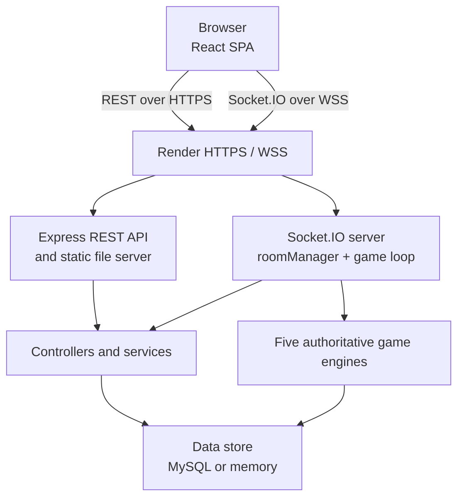

## 15.1 Layer responsibilities

- **Presentation layer:** React pages, reusable components, five game UIs and local handoff screens.
- **Application layer:** Express routes, controllers, validation, authentication and achievement service.
- **Real-time layer:** Socket authentication, room manager, game loop, chat and event broadcasting.
- **Domain layer:** Five game engines and shared scoring helpers.
- **Data layer:** `memoryStore` or `mysqlStore` behind one common store interface.
- **Deployment layer:** One Render service that serves all layers from one origin.

## 15.2 Important design principle

The server never trusts the browser for scores or winners. A browser sends an action such as a board cell, column or tap. The engine applies the rules and returns a view to each player. Only the server calls `finishMatch`, `recordMatchStats` and `checkAchievements`.

Local mode is the deliberate exception in terms of storage: it runs those same engines inside the browser session but does not use sockets, REST or persistent storage.

---

# 16. SDLC methodology

FunZone followed an iterative, incremental SDLC suitable for a college mini-project.

| Phase | Activities in FunZone |
| --- | --- |
| 1. Planning | Selected the problem, five games, two play modes and a single-origin deployment approach. |
| 2. Requirements | Identified functional requirements such as rooms, readiness, chat, results and profiles, plus non-functional requirements such as security and responsiveness. |
| 3. Design | Designed REST endpoints, Socket.IO events, game-engine contract, database schema and UI structure. |
| 4. Implementation | Built the backend engines and API first, then real-time rooms, then the React UI and local pass-and-play driver. |
| 5. Testing | Added engine, API, local and socket integration tests; fixed issues; verified the production build. |
| 6. Deployment | Added `render.yaml`, deployed from GitHub `main`, documented the live URL and health check. |
| 7. Maintenance and audit | Verified GitHub state, secrets, live pages, health, latest commit, local games and a complete online match. |

Each phase produced working increments rather than a single big release. For example, the local multiplayer increment was committed as `eedb4b2` without replacing the existing online multiplayer system.

---

# 17. DFD Level 0 and Level 1

## 17.1 DFD Level 0

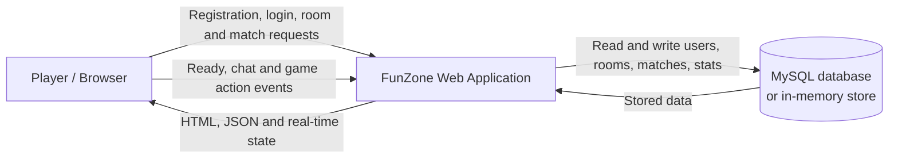

## 17.2 DFD Level 1

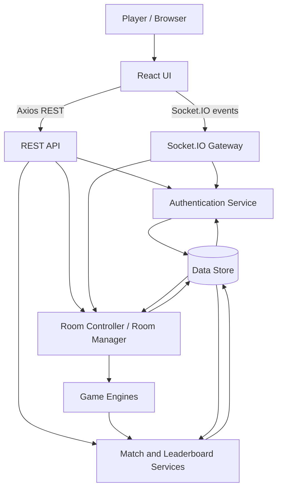

The Level 1 diagram shows that authentication is shared by REST and sockets, while game actions flow through the room manager into the authoritative engine. Match services write final data to the active store.

---

# 18. Use case diagram

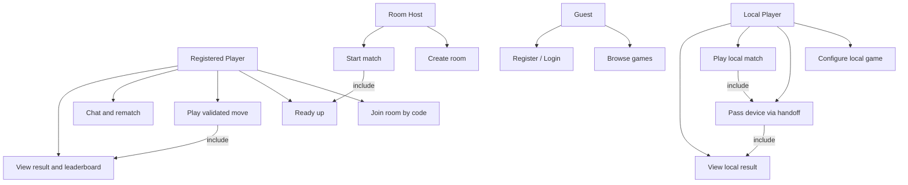

Key actors are guest, registered player, room host and local player. Only the host can start an online match. Local players do not need an account because local routes are public and session state lives only in React context.

---

# 19. ER diagram

```mermaid
erDiagram
    USERS ||--o| PLAYER_PROFILES : has
    USERS ||--o{ GAME_ROOMS : hosts
    GAME_ROOMS ||--o{ ROOM_PLAYERS : contains
    USERS ||--o{ ROOM_PLAYERS : joins
    GAME_ROOMS ||--o{ MATCHES : records
    MATCHES ||--o{ MATCH_PLAYERS : includes
    USERS ||--o{ MATCH_PLAYERS : participates
    USERS |o--o{ MATCHES : wins
    ACHIEVEMENTS ||--o{ USER_ACHIEVEMENTS : unlocked_as
    USERS ||--o{ USER_ACHIEVEMENTS : earns

    USERS {
        CHAR_36 id PK
        VARCHAR_32 username UK
        VARCHAR_120 email UK
        VARCHAR_255 password_hash
        DATETIME created_at
        DATETIME updated_at
    }
    PLAYER_PROFILES {
        CHAR_36 user_id PK_FK
        VARCHAR_64 avatar
        VARCHAR_16 avatar_color
        VARCHAR_240 bio
        INT xp
        INT level
        INT total_matches
        INT wins
        INT losses
        INT draws
        DATETIME updated_at
    }
    GAME_ROOMS {
        CHAR_36 id PK
        VARCHAR_8 code UK
        VARCHAR_32 game_type
        CHAR_36 host_id FK
        TINYINT max_players
        TINYINT is_private
        ENUM status
        DATETIME created_at
        DATETIME closed_at
    }
    ROOM_PLAYERS {
        CHAR_36 id PK
        CHAR_36 room_id FK
        CHAR_36 user_id FK
        TINYINT is_host
        TINYINT is_ready
        TINYINT seat
        DATETIME joined_at
    }
    MATCHES {
        CHAR_36 id PK
        CHAR_36 room_id FK
        VARCHAR_32 game_type
        CHAR_36 winner_id FK
        TINYINT is_draw
        SMALLINT_UNSIGNED duration_seconds
        JSON final_state
        ENUM status
        DATETIME started_at
        DATETIME ended_at
    }
    MATCH_PLAYERS {
        CHAR_36 id PK
        CHAR_36 match_id FK
        CHAR_36 user_id FK
        INT score
        TINYINT position
        ENUM outcome
    }
    ACHIEVEMENTS {
        CHAR_36 id PK
        VARCHAR_48 code UK
        VARCHAR_80 name
        VARCHAR_180 description
        VARCHAR_16 icon
    }
    USER_ACHIEVEMENTS {
        CHAR_36 id PK
        CHAR_36 user_id FK
        CHAR_36 achievement_id FK
        DATETIME unlocked_at
    }
```

The diagram is based on `database/schema.sql`: eight tables, one profile per user, many rooms per host, many players per room, many matches per room, many player rows per match and many-to-many achievements through `user_achievements`.

---

# 20. Database design

## 20.1 Table summary

| Table | Primary key | Important constraints / indexes | Purpose |
| --- | --- | --- | --- |
| `users` | `id CHAR(36)` | Unique `username`, unique `email`; stores `password_hash`. | Account identity. |
| `player_profiles` | `user_id CHAR(36)` | FK to `users(id)` with `ON DELETE CASCADE`. | Avatar, bio, XP, level and stats. |
| `game_rooms` | `id CHAR(36)` | Unique `code`; FKs to host user; indexes on `status` and `game_type`. | Room metadata. |
| `room_players` | `id CHAR(36)` | Unique `(room_id, user_id)`; FKs to room and user. | Seats, ready flags, host flag. |
| `matches` | `id CHAR(36)` | FKs to room and winner; indexes on game, start time and winner. | Completed match record. |
| `match_players` | `id CHAR(36)` | Unique `(match_id, user_id)`; FKs to match and user. | Final score, position and outcome. |
| `achievements` | `id CHAR(36)` | Unique `code`. | Achievement catalogue. |
| `user_achievements` | `id CHAR(36)` | Unique `(user_id, achievement_id)`; FKs to user and achievement. | Unlocked achievements. |

## 20.2 Status and outcome values

- `game_rooms.status`: `waiting`, `playing`, `finished`.
- `matches.status`: `playing`, `finished`.
- `match_players.outcome`: `win`, `loss`, `draw`.
- `game_rooms.is_private` and readiness flags are stored as `TINYINT(1)`.

## 20.3 Seeded achievements

| Code | Name | Description | Icon |
| --- | --- | --- | --- |
| `first_match` | First Steps | Play your first match | gamepad |
| `first_win` | Sweet Victory | Win your first match | trophy |
| `five_wins` | On a Roll | Win 5 matches | fire |
| `all_games` | Explorer | Play all five games | compass |
| `level_5` | Veteran | Reach level 5 | star |

## 20.4 Store selection

`DATA_STORE` supports `memory`, `mysql` and `auto`. In `auto` mode, MySQL is attempted only when a database password is configured; failure falls back to memory after a timeout. The current Render service explicitly uses `memory`, so live data is temporary.

---

# 21. Module descriptions

## 21.1 Client modules

| Module | Responsibility |
| --- | --- |
| `App.jsx` | Routes all pages and applies protection/local provider wrapping. |
| `api/client.js` | Axios instance, bearer-token interceptor and API wrappers. |
| `context/AuthContext.jsx` | User state and auth actions. |
| `context/SocketContext.jsx` | Socket lifecycle and connection state. |
| `context/ToastContext.jsx` | Temporary notifications. |
| `pages/` | Landing, auth, dashboard, games, rooms, waiting room, live game, results, leaderboard, profile and local pages. |
| `components/` | Navbar, Layout, Avatar, Icon, GameCard and reusable UI primitives. |
| `games/` | Five presentational game components sharing `state`, `myId` and `act`. |
| `local/localSession.js` | Framework-independent pass-and-play session driver. |
| `local/LocalGameContext.jsx` | React state wrapper for one local session. |
| `local/LocalHandoff.jsx` | Full-screen privacy/pass-device screen. |
| `local/LocalResults.jsx` | Local standings and rematch controls. |
| `styles/index.css` | Dark glassmorphism design system and responsive breakpoints. |

## 21.2 Server modules

| Module | Responsibility |
| --- | --- |
| `config/env.js` | Reads environment variables with safe development defaults. |
| `app.js` | Helmet, CORS, JSON parsing, rate limits, routes, static serving and error middleware. |
| `server.js` | Store initialisation, HTTP/Socket.IO setup and graceful shutdown. |
| `routes/index.js` | Public and authenticated REST route table. |
| `controllers/` | Auth, user, room, match and leaderboard request handling. |
| `middleware/` | Authentication, validation and `AppError`. |
| `services/achievements.js` | Evaluates and unlocks the five achievements. |
| `db/` | Common store interface with memory and MySQL implementations. |
| `socket/` | Socket authentication, handlers and room manager. |
| `games/` | Five engines, shared helpers and game catalogue. |

## 21.3 Game-engine contract

| Function | Purpose |
| --- | --- |
| `create(players)` | Creates the initial authoritative state. |
| `apply(state, action, userId)` | Validates and applies one intent. |
| `onTimeout(state)` | Handles a deadline expiry. |
| `tick(state, now)` | Optional periodic work; only Quick Tap uses it. |
| `result(state)` | Produces final scores, winners and reason. |
| `view(state, userId)` | Produces the player-safe state sent to a client. |

---

# 22. Online multiplayer functionality

## 22.1 Room lifecycle

1. A signed-in player selects a game on `/rooms`.
2. `POST /api/rooms` creates a six-character code and seats the host at seat 0. The host starts ready.
3. Another signed-in player calls `POST /api/rooms/:code/join`.
4. Both clients emit `room:join`; the server checks REST membership before adding the socket to the Socket.IO room.
5. `player:ready` updates readiness while the room is waiting.
6. The host emits `room:start`; the server checks minimum players, capacity, connection and readiness.
7. The server creates the game state, sets `status='playing'` and broadcasts the first `room:state`.
8. Players send `game:action` intents. The engine validates them and timers run in a 250 ms server loop.
9. `endGame` saves the match, updates stats and achievements, emits `game:ended` and broadcasts final state.
10. `room:rematch` resets the engine and returns the same players to the waiting room.

## 22.2 Real-time details

- Chat messages are trimmed to 160 characters and kept up to 50 in runtime state.
- A disconnect starts a 15-second grace period. If the player does not return, the match ends or the host is transferred as appropriate.
- `room:state` is personalised with `engine.view(state, userId)`, so each player receives only what they are allowed to see.
- The game loop calls `tick()` only for Quick Tap and handles deadlines for the other games.

## 22.3 Result persistence

The result page fetches `GET /api/matches/:id`. The match ID comes from `game:ended`. Scores, winners and the “Saved” indicator come from the active store. In memory mode, the saved record disappears when the service restarts.

---

# 23. Local multiplayer functionality

## 23.1 Design

Local mode is implemented in `client/src/local/`. It imports the same five engines used by the server and drives them entirely in the browser. It does not call REST, open Socket.IO, create an account or write match results online.

## 23.2 Session flow

1. Choose a game at `/local` and open `/local/setup/:gameId`.
2. Enter two to eight names, depending on the game. Names are trimmed, defaulted to `Player N` and capped at 18 characters.
3. `createLocalSession` assigns synthetic IDs `local-1…local-N`, avatars and colours, then creates engine state with `create(players)`.
4. Screen states are `playing`, `handoff`, `review`, `reveal` and `result`.
5. After a move or choice, `LocalHandoff` covers the board with “please look away” text and a game-specific privacy note.
6. The next player taps “I'm … — start my turn” to resume; clocks stop during handoff.
7. `LocalResults` shows sorted standings, winner labels, result reason, rematch and game-selection actions.

## 23.3 Privacy by game

| Game | Local privacy behaviour |
| --- | --- |
| Tic Tac Toe / Connect Four | Full-screen handoff hides the board between moves. |
| Rock Paper Scissors | Opponent choice shows `✅` or `❔` until the reveal screen; `lastReveal` is cleared between rounds. |
| Memory Match | Handoff covers cards; review shows pair/miss result before passing the device. |
| Quick Tap | Handoff hides the previous player's score and starts a fresh 10-second turn. |

## 23.4 Isolation

`LocalGameProvider` is mounted only under the `/local` route. Leaving local mode unmounts the provider and discards the session. Nothing is written to `localStorage` or a database. Rematch rebuilds a fresh immutable session with the same player names.

---

# 24. Detailed explanation of all five games

## 24.1 Tic Tac Toe

- **Players:** 2.
- **Online timer:** 20 seconds per turn.
- **Board:** 3×3; player 0 uses X and moves first.
- **Action:** `{ type: 'move', cell }` with cell 0–8.
- **Validation:** Out-of-turn, occupied, non-integer and out-of-range cells are rejected.
- **Result:** Eight line checks detect a win; a full board is a draw; timeout gives the opponent the win.
- **Reasons:** `three-in-a-row`, `board-full`, `timeout`.
- **Scores:** winner 3, loser 1, draw 1 each.

## 24.2 Rock Paper Scissors

- **Players:** 2–8.
- **Rounds:** 5, with a 15-second choosing phase and a 3-second reveal phase online.
- **Action:** `{ type: 'choice', choice }`, where choice is `rock`, `paper` or `scissors`.
- **Rules:** Rock beats scissors, paper beats rock, scissors beats paper. Same choice gives all choosers one point; three distinct choices give no points.
- **Result:** Unique top scorer wins after five rounds; tied top is a draw.
- **Reason:** `rounds-complete`.
- **Local privacy:** Choices are hidden with handoff/reveal screens.

## 24.3 Connect Four

- **Players:** 2.
- **Online timer:** 20 seconds per turn.
- **Board:** 7 columns × 6 rows, stored as stacks.
- **Action:** `{ type: 'drop', column }` with column 0–6.
- **Validation:** Gravity is enforced; full and invalid columns are rejected.
- **Result:** Four in a row horizontally, vertically or diagonally wins. A full board is a draw; timeout gives the opponent the win.
- **Reasons:** `connect-four`, `board-full`, `timeout`.

## 24.4 Memory Match

- **Players:** 2–4.
- **Online timer:** 25 seconds per turn.
- **Cards:** 16 cards made from 8 emoji symbols, shuffled with a cryptographically random helper.
- **Action:** `{ type: 'flip', index }` with index 0–15.
- **Rules:** A pair gives +2 and keeps the turn. A mismatch passes the turn. All pairs found ends the match.
- **Online security:** `view()` replaces hidden symbols with `null`.
- **Local behaviour:** Real symbols stay in browser memory, but the handoff screen covers them.
- **Reason:** `all-pairs-found`.

## 24.5 Quick Tap

- **Players:** 2–8.
- **Online duration:** 30 seconds shared match.
- **Local duration:** 10 seconds per player turn.
- **Board:** 5×5 grid, 25 cells.
- **Action:** `{ type: 'tap', cell }` with cell 0–24.
- **Scoring:** Hit = `clamp(20 - floor(elapsedSinceSpawn / 120), 5, 20)`. Miss = −2 points, floored at 0. Cooldown = 80 ms per player.
- **Target:** Respawns immediately after a hit or after 1.8 seconds.
- **Result:** Unique top score wins; tied top is a draw.
- **Reason:** `time-up`.

---

# 25. UI screenshots or screenshot placeholders with instructions

All images below were captured from the live deployed website during the final audit and copied into `docs/screenshots/`.

## 25.1 Captured screenshots

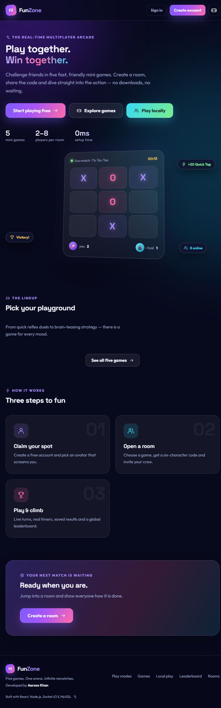

*Figure 25.1 — Live homepage showing the hero section and call-to-action links.*

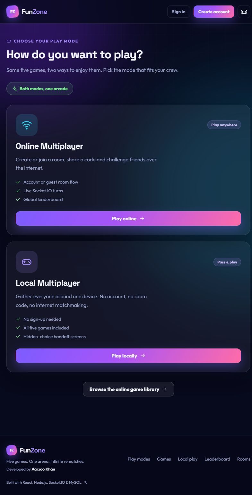

*Figure 25.2 — `/play` mode chooser for Online and Local play.*

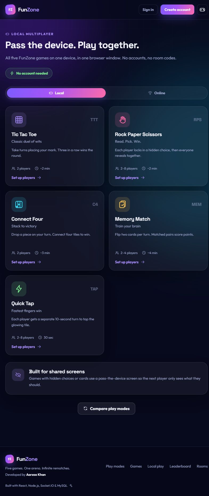

*Figure 25.3 — `/local` showing the five local pass-and-play games.*

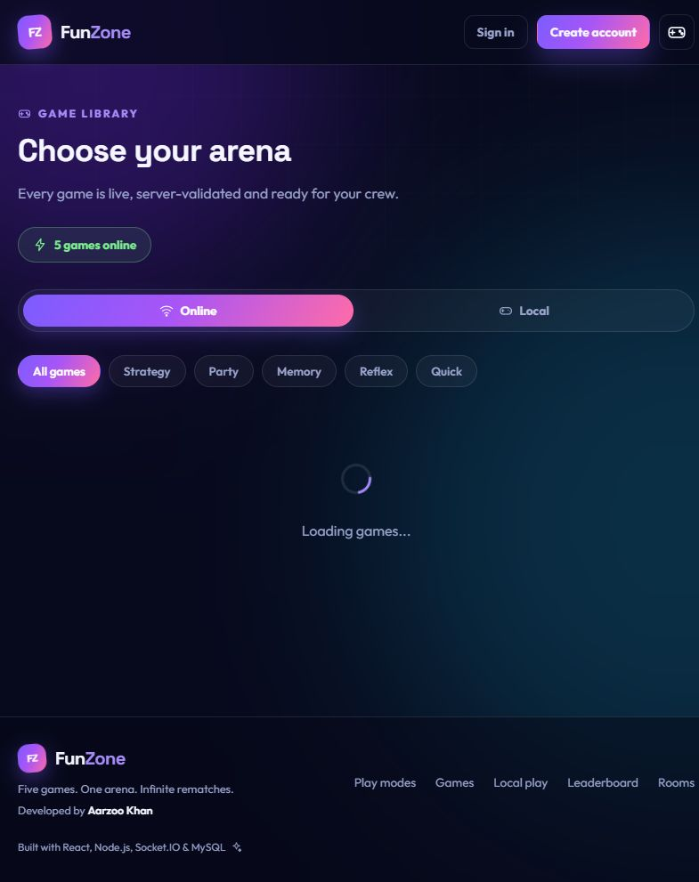

*Figure 25.4 — `/games` online catalogue with filters and game cards.*

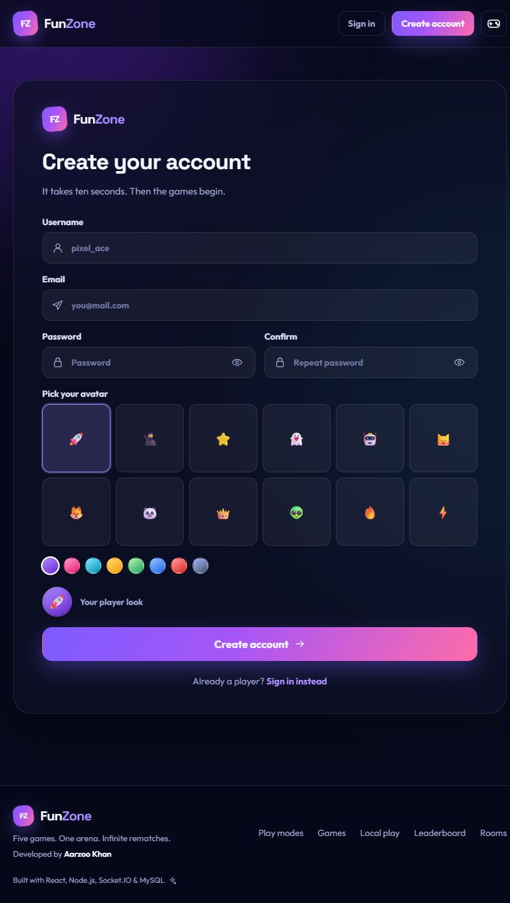

*Figure 25.5 — Registration form with username, email, password and avatar selection.*

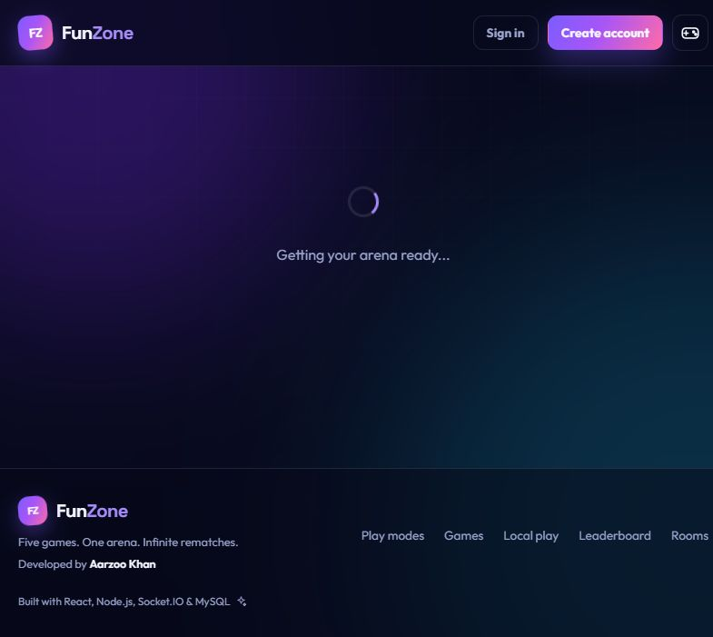

*Figure 25.6 — Result page for the audited online match with final standings.*

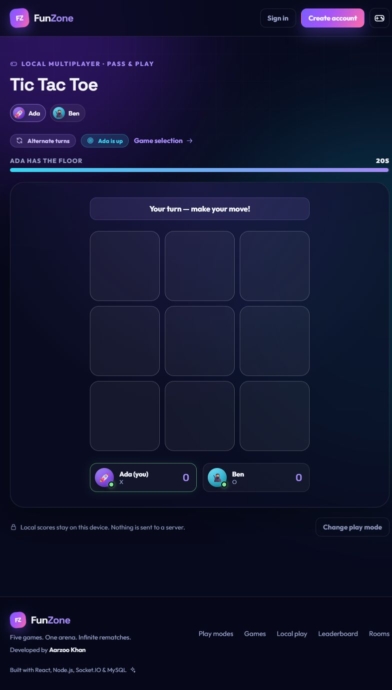

*Figure 25.7 — Local Tic Tac Toe running on the live deployment.*

## 25.2 Screenshot placeholders for the college copy

| Figure | Required view | Instruction if a fresh capture is needed |
| --- | --- | --- |
| 25.8 | Login page | Open `https://funzone-k94k.onrender.com/login` and capture the full page. |
| 25.9 | Protected dashboard | Sign in, open `/dashboard`, capture stats, achievements and recent matches. |
| 25.10 | Waiting room | Create a room, copy the code, capture the waiting room with two players ready. |
| 25.11 | Live online game | Start a match, capture the board and timer while it is the player's turn. |
| 25.12 | Leaderboard | Open `/leaderboard` and capture the podium and ranking table. |
| 25.13 | Local handoff | Start a local game, make one move and capture the “please look away” screen. |
| 25.14 | API health | Open `/api/health` and capture the JSON response. |

Use full-page screenshots at 1366×768 or higher. Remove any real email addresses, tokens or other personal data before inserting them into a submitted document.

---

# 26. Implementation details

## 26.1 Frontend implementation

- `main.jsx` wraps the app in `BrowserRouter`, `AuthProvider`, `ToastProvider` and `SocketProvider`.
- Axios uses `/api` as base URL and attaches `funzone_token` from `localStorage`.
- A 401 response removes the token except on the login request.
- Socket.IO connects to the same origin with websocket and polling transports and up to 10 reconnection attempts.
- Game components are presentational; `GamePage` translates `act(...)` into `socket.emit('game:action', { action })`.
- `LocalGamePage` translates the same `act(...)` into `applyLocalAction(...)`.
- The CSS design system uses Outfit and Space Grotesk fonts, glass panels, animated backgrounds, component tokens and breakpoints at 1050, 820 and 600 pixels. Reduced-motion preferences are respected.

## 26.2 Backend implementation

- `env.js` loads `.env` and supplies development defaults. Production requires a real secret configuration.
- `app.js` sets Helmet, CORS, 1 MB JSON parsing, auth rate limits, `/api` routes, static files and JSON error responses.
- `server.js` initialises the store before listening, attaches Socket.IO and starts the 250 ms game loop.
- Serial IDs are UUIDs; room codes use an unambiguous alphabet excluding O, 0, I and 1.
- MySQL SQL is parameterised, and transactions are used for host transfer and match-stat updates.
- The memory store uses eight `Map` objects and returns `structuredClone` copies to prevent accidental mutation.
- XP is 50 for a win, 20 for a loss and 15 for a draw; level is `floor(xp / 150) + 1`.

## 26.3 Testing implementation

- `node:test` and `node:assert/strict` are used; no external test runner is required.
- API and socket tests boot real Express/Socket.IO instances on ephemeral ports.
- Local tests import the browser session driver directly.
- The game loop is unref'd so tests and shutdown are not blocked.
- Test mode raises the auth rate limit to avoid false failures.

---

# 27. Testing strategy and actual test results

## 27.1 Strategy

| Level | What was tested | Tool |
| --- | --- | --- |
| Unit | Pure game-engine rules. | `node:test` |
| API | Health, auth, rooms, profile, leaderboard and history. | Real Express app on ephemeral port. |
| Local integration | All five local sessions, handoff, privacy, timeout and rematch. | `local_games.test.js` |
| Online integration | Two socket clients per match, readiness, turns, results, persistence. | `socket.io-client` |
| Build | Production bundle generation. | `npm run build` |
| Live UI | Pages, local games, online room flow and result page. | In-app Chromium browser. |
| Live real-time | Independent guest player against browser host. | Node `socket.io-client` process. |

## 27.2 Automated results

Command: `npm test`

Result: **32 tests, 32 passed, 0 failed, 0 skipped**.

| Test file | Cases |
| --- | ---: |
| `server/tests/games.test.js` | 7 |
| `server/tests/api.test.js` | 6 |
| `server/tests/local_games.test.js` | 9 |
| `server/tests/multiplayer.test.js` | 1 |
| `server/tests/multiplayer_games.test.js` | 4 |
| `server/tests/mysql_tls.test.js` | 5 |
| **Total** | **32** |

## 27.3 Build results

Command: `npm run build`

Result: Passed with Vite 6.4.6; 160 modules transformed.

```text
dist/index.html                    0.95 kB  │ gzip:   0.59 kB
dist/assets/index-BOS7OokV.css    51.49 kB  │ gzip:  10.84 kB
dist/assets/index-B8Gargke.js   371.39 kB  │ gzip: 116.95 kB
```

## 27.4 Live results

- All five local games opened and played successfully on the live site.
- Local results observed: Tic Tac Toe 3/1, Connect Four 3/1, Rock Paper Scissors 5/0, Memory Match pair/mismatch/handoff verified, Quick Tap 20/19.
- Online room `VN832H` was created through the browser. An independent guest joined after REST membership, readied, played and received `game:ended`.
- Match `9fd330bd-6857-484d-82c7-08a94eeb1251` ended with host winner, scores 3/1 and reason `three-in-a-row`.
- No browser console errors were recorded during the page, local game or online flow checks.
- Other online games were not manually completed live; their flows passed automated socket integration tests.

The detailed evidence is in `docs/FINAL_TESTING_REPORT.md`.

---

# 28. Deployment process

1. Source is committed to GitHub on the `main` branch.
2. `render.yaml` defines a free Node Web Service with `autoDeploy: true`.
3. Render runs `npm install --include=dev && npm run build`. Including dev dependencies is necessary because Vite builds the client.
4. Vite writes `dist/index.html` and hashed assets.
5. Render starts the app with `npm start`, which runs `server/src/server.js`.
6. Express serves `dist/` and SPA fallback routes; the same process hosts `/api` and `/socket.io`.
7. `GET /api/health` is used as the platform health check.
8. Environment variables set production mode, port 10000, client URL, memory data mode and a Render-generated JWT secret.
9. The live site was verified to serve the same asset hashes as the latest local build, confirming commit `eedb4b2` is deployed.

No Render environment variable or paid setting was changed during the final audit.

---

# 29. Security considerations

| Consideration | Implementation |
| --- | --- |
| Password storage | bcryptjs hash with cost factor 12; no plain password or hash in API responses. |
| Session security | Signed JWT with 7-day default expiry; bearer token required for protected routes and sockets. |
| Token handling | Stored in `localStorage`; removed on 401 and logout. |
| Transport security | Render serves HTTPS and WSS from one origin. |
| Origin control | CORS and Socket.IO origin list from `CLIENT_URL`. |
| Headers | Helmet security headers. |
| Brute force | Rate limiting on login and registration. |
| Input validation | Registration, login and profile validators; engine-level action validation. |
| Fair play | Server-authoritative state, timers and scoring. |
| Hidden information | Online Memory face-down symbols are `null` in each client view; RPS reveal is controlled by the engine. |
| Error handling | Generic production 500 message; `AppError` statuses; JSON 404 for unknown API routes. |
| Secrets | `.env` and `.env.local` gitignored; only `.env.example` tracked; Render generates `JWT_SECRET`. |

For a production public release, further work would be needed on persistent secret management, token revocation, monitoring, abuse controls and HTTPS cookie-based sessions.

---

# 30. Limitations

1. **Memory data is temporary.** The live service uses `DATA_STORE=memory`; accounts and match history are cleared on restart.
2. **MySQL was not verified live.** The schema and store exist, but no credentials were supplied.
3. **Free-tier cold start.** Render's free instance sleeps after inactivity, delaying the first request.
4. **Profile save was fixed and regression-tested.** `ProfilePage.jsx` now reads `data.profile` from the Axios response with `try/catch/finally` error handling, and both data stores persist `avatarColor` as `avatar_color`. A dedicated API test covers success, persistence, partial updates, validation failures and missing authentication.
5. **Local privacy is UI-level.** Players must honestly pass the device; local state is in browser memory.
6. **Limited online manual coverage.** One full online match was played live; the other four online games passed automated integration tests only.
7. **Older documents were stale and have been updated.** `docs/TESTING_REPORT.md` and `docs/DEVELOPMENT_PROGRESS.md` now reflect 32 tests, both play modes and the live Render deployment.
8. **No extra features.** There is no voice/video chat, spectator mode, tournament bracket or native mobile app.
9. **Screenshots need human review.** They were captured from the live site but not visually inspected by the report generator.

None of these limitations blocked the performed tests or the deployed gameplay checks.

---

# 31. Future enhancements

- Connect a managed MySQL database so accounts, results and achievements persist across restarts.
- Add a short-lived token refresh and explicit logout revocation list for stronger session control.
- Add Playwright browser tests for online and local modes in separate contexts.
- Add browser-level tests (Playwright) for the profile editor success and error toasts.
- Add friend lists, invitations and optional public room browsing.
- Add spectators, rematch tournaments and per-game player statistics.
- Add optional sound effects, keyboard shortcuts and stronger accessibility settings.
- Expand achievements and add seasonal leaderboards.
- Keep the README and older testing/progress documents in sync with new features.
- Monitor Render health and uptime if the project is used beyond college demonstration.

---

# 32. Conclusion

FunZone successfully delivers five playable mini games in one full-stack web application. Online multiplayer uses REST and Socket.IO with authoritative server validation, room codes, chat, readiness, rematch, saved results and leaderboards. Local multiplayer reuses the same engines without accounts, sockets or online persistence and adds full-screen handoff screens for fair pass-and-play.

The final audit confirmed that the latest local multiplayer commit `eedb4b2` is pushed to GitHub `main` and deployed on Render. The health endpoint is healthy, all requested pages load, all five local games work on the live site, and a complete online match produced a saved result with correct scores and winner. The automated suite passes 32/32 tests and the production build succeeds.

All academic details are confirmed and filled in, including the submission date of 23 November 2026. The remaining work is limited to optionally updating older documentation and manually verifying live MySQL if the college requires it. The project is ready for final submission documentation.

---

# 33. Bibliography

1. React Team. *React Documentation*. https://react.dev/
2. Vite Team. *Vite Documentation*. https://vite.dev/
3. Node.js Foundation. *Node.js Documentation*. https://nodejs.org/en/docs/
4. Express.js Team. *Express Documentation*. https://expressjs.com/
5. Socket.IO Team. *Socket.IO Documentation*. https://socket.io/docs/v4/
6. Auth0. *JSON Web Token Introduction*. https://jwt.io/introduction
7. bcryptjs project. *bcryptjs Documentation*. https://github.com/dcodeIO/bcrypt.js
8. MySQL Documentation Team. *MySQL 8.0 Reference Manual*. https://dev.mysql.com/doc/
9. Render Team. *Render Documentation*. https://render.com/docs
10. GitHub Docs. *GitHub Flow and Branch Management*. https://docs.github.com/
11. MDN Web Docs. *WebSockets API*. https://developer.mozilla.org/en-US/docs/Web/API/WebSockets_API
12. Node.js Team. *Node Test Runner Documentation*. https://nodejs.org/api/test.html

Internal project references: `README.md`, `docs/API_DOCUMENTATION.md`, `docs/FINAL_TESTING_REPORT.md`, `database/schema.sql`, `render.yaml`, and the source files under `client/src/`, `server/src/` and `server/tests/`.

---

# 34. User manual

## 34.1 First-time setup

1. Open `https://funzone-k94k.onrender.com`.
2. Allow up to a minute if the free Render instance is waking from sleep.
3. Choose **Create account** and enter a username, email, password and confirmation password.
4. Pick an avatar and colour, then submit.
5. For local play only, no account is needed: open `/local` directly.

## 34.2 Playing online

1. Open **Games** and choose a game, or open **Rooms** and select one there.
2. Keep the room private for a code-only game, or make it public if desired.
3. Adjust the player count within the game's allowed range and choose **Create room**.
4. Copy the six-character room code and share it.
5. Other players open **Rooms**, enter the code and choose **Join room**.
6. In the waiting room, each player confirms readiness. The host chooses **Start game** when everyone is ready.
7. Play by clicking your legal move. A timer and turn banner show the active player.
8. Use room chat only for short messages; it is limited to 160 characters.
9. When the match ends, review final standings. Choose **Rematch** to return to the waiting room or **Play something else** to browse games.

## 34.3 Playing locally

1. Open **Play** and choose **Local**, or go directly to `/local`.
2. Choose one of the five games.
3. Enter two to eight player names, depending on the game.
4. Choose **Start local game**.
5. When the handoff screen appears, the previous player should look away and pass the device.
6. The next player confirms their name to start their turn.
7. Continue until the result screen appears.
8. Choose **Rematch**, **Choose another game** or **Change play mode**.

## 34.4 Game controls

| Game | Control |
| --- | --- |
| Tic Tac Toe | Click an empty square on your turn. |
| Rock Paper Scissors | Click rock, paper or scissors privately, then reveal. |
| Connect Four | Click the column where you want to drop a piece. |
| Memory Match | Flip two cards; a pair keeps your turn. |
| Quick Tap | Click the highlighted target as quickly as possible; avoid wrong cells. |

## 34.5 Where to find information

- **Dashboard:** personal stats, XP, achievements and recent matches.
- **Leaderboard:** rankings overall and per game.
- **Profile:** avatar, colour, bio and achievement display.
- **Match history:** recent completed online matches.
- **Health check:** `/api/health` for service status.

## 34.6 Troubleshooting

| Problem | What to do |
| --- | --- |
| First load is slow | Wait for the free Render instance to wake and retry. |
| Dashboard redirects to login | Sign in; protected pages require a valid JWT. |
| “Join the room with its code before entering” | Join with REST from `/rooms` first, then the socket will attach. |
| Room code not accepted | Confirm all six characters; ambiguous O/0 and I/1 are not used. |
| Start button disabled | Ensure all players are connected and ready and the room has enough players. |
| Local state disappears | Leaving `/local` unmounts the local session; start again. |
| Live data missing after restart | Memory mode is expected to clear demo data on restart. |
